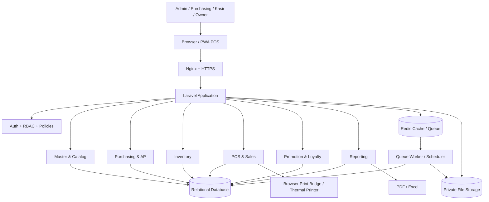
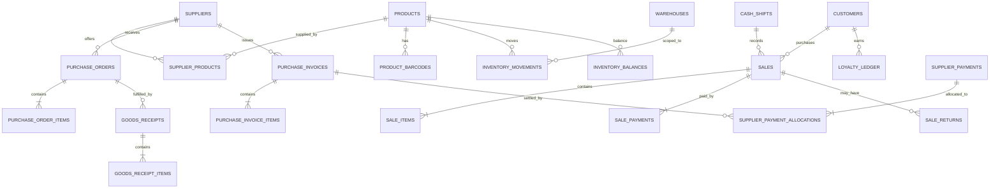
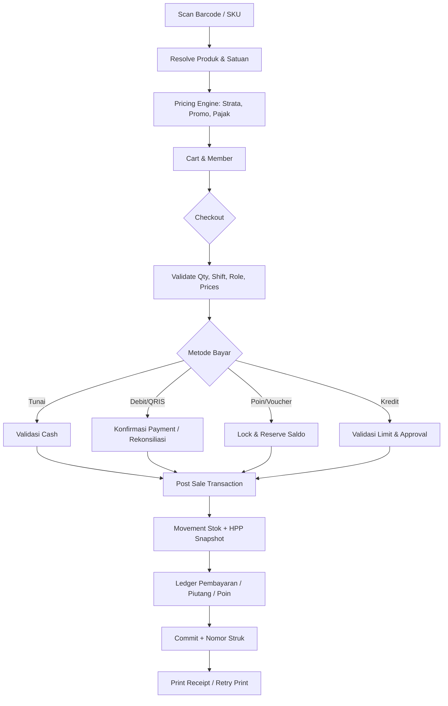

# ARCHITECTURE.md — Retail Management System

**Produk:** Retail Management System (POS, Inventory, Purchasing, Promotions & Loyalty)  
**Versi:** 1.0 | **Tanggal:** 22 Oktober 2026 | **Status:** Baseline implementasi  
**Acuan:** `PRD_Retail_Management_System.md`  
**Target awal:** satu toko / satu cabang, siap berkembang ke multi-cabang.

> Dokumen ini merupakan keputusan arsitektur awal, bukan klaim bahwa sistem telah dibangun. Hal yang belum ditentukan pengguna dicantumkan sebagai asumsi atau keputusan yang masih perlu ditetapkan.

## 1. Sasaran dan Prinsip Desain

1. **Integritas stok:** kuantitas berubah hanya melalui transaksi stok terposting; setiap perubahan harus dapat direkonsiliasi.
2. **Integritas keuangan:** hutang, pembayaran, kasir, refund, dan poin memiliki ledger/jejak yang dapat diaudit.
3. **Transaksi idempotent:** permintaan ganda atau double-click tidak boleh menduplikasi PO, penerimaan, penjualan atau pembayaran.
4. **Kinerja POS:** operasi scan dan hitung keranjang responsif; posting transaksi aman terhadap konkurensi.
5. **Separation of concerns:** antarmuka, validasi, kasus penggunaan, domain, dan akses database tidak dicampur dalam controller.
6. **Modular dan pragmatis:** satu aplikasi Laravel modular (modular monolith), bukan microservices pada versi awal.
7. **Audit dan otorisasi:** setiap void, koreksi stok, diskon khusus, edit harga, dan pelunasan memiliki aktor dan alasan.
8. **Historical snapshot:** harga, pajak, diskon, HPP, dan atribut relevan transaksi disimpan saat posting, tidak dihitung ulang memakai master terkini.
9. **Konfigurasi fiskal:** tarif dan status PPN disimpan secara configurable/effective-dated; implementasi pajak harus divalidasi dengan akuntan dan aturan Indonesia saat go-live.

## 2. Ruang Lingkup

**Termasuk:** master barang/supplier/rak/member; PO dan penerimaan; pembelian tunai/kredit/konsinyasi; mutasi dan opname; bundling; retur supplier; price card/barcode; hutang/pelunasan; POS; penjualan kredit; EOD; promosi, poin, voucher; laporan/ekspor.

**Tidak menjadi baseline fase awal:** full general ledger akuntansi, payroll, e-commerce, multi-currency, aplikasi seluler native, sinkronisasi POS offline lintas perangkat, integrasi API otomatis seluruh EDC. Semua dapat menjadi ekstensi setelah kebutuhan tervalidasi.

## 3. Stack yang Diusulkan

| Lapisan | Pilihan awal | Alasan |
|---|---|---|
| Bahasa & backend | PHP + versi Laravel stabil yang kompatibel dengan infrastruktur | Ekosistem, job, otorisasi, migrasi, testing |
| Frontend back-office | Blade + Livewire + Alpine.js + Tailwind CSS | Satu codebase, CRUD cepat, pemeliharaan sederhana |
| POS frontend | Blade/Livewire dengan state keranjang klien yang ringan | Input barcode/keyboard cepat; jangan round-trip pada setiap penekanan tombol |
| Basis data | MariaDB dengan InnoDB (11.8.8 terverifikasi lokal) | Database utama development dan production; transaksi ACID, index, row lock |
| Cache / queue | Redis (opsional awal, dianjurkan produksi) | Cache, lock, job ekspor, pembuatan brosur |
| Penyimpanan | Private local/S3-compatible; file public terbatas | Foto produk, template, invoice, ekspor |
| Login | Laravel session auth + MFA untuk akun istimewa | Proteksi admin |
| Authorization | Policies/Gates dan permission matrix (opsional paket RBAC matang) | Otorisasi per aksi/cabang |
| Monitoring | Application logs, audit logs, error tracking, metrics | Investigasi transaksi |
| Deploy | Linux VPS, Nginx, PHP-FPM, DB, worker dan scheduler | Sesuai preferensi implementasi Laravel |

Tidak mengunci nomor versi framework/library sebelum pemeriksaan kompatibilitas aktual. Simpan dependency terkunci (`composer.lock`, lockfile frontend).

## 4. Diagram Arsitektur



**Penting:** printer thermal berbasis USB tidak dapat selalu dicetak diam-diam dari web murni. Pilih jalur cetak browser atau local print bridge yang diinstal di komputer kasir; sertifikat, autentikasi lokal, dan whitelist printer diperlukan pada print bridge. Jangan mengasumsikan VPS dapat mengakses printer USB di komputer toko secara langsung.

## 5. Struktur Kode Laravel yang Disarankan

```text
app/
  Domain/
    Catalog/{Models,Enums,Services,Policies}
    Suppliers/{Models,Services}
    Purchasing/{Models,Actions,Services,Enums}
    Inventory/{Models,Actions,Services,Enums}
    Sales/{Models,Actions,Services,Enums}
    Pricing/{Services,Rules}
    Loyalty/{Models,Actions,Services}
    AccountsPayable/{Models,Actions,Services}
    Reports/{Queries,Exports}
    Shared/{Money,DTOs,Exceptions}
  Http/{Controllers,Requests,Middleware}
  Livewire/{Dashboard,Master,Purchasing,Inventory,Pos,Promotions,Reports}
  Jobs/{GenerateReport,GeneratePromoBrochure,SendAlert}
  Events/{PurchasePosted,SalePosted,StockAdjusted,PaymentSettled}
  Listeners/
  Policies/
database/{migrations,seeders,factories}
resources/{views,css,js}
routes/{web.php,api.php,console.php}
tests/{Unit,Feature,Integration}
docs/{PRD.md,architecture.md,design.md}
```

**Pembagian tanggung jawab:** FormRequest memvalidasi bentuk input; Action/UseCase mengeksekusi proses bisnis; Domain Service menghitung harga/HPP/poin; Model menyimpan entitas; Policy melindungi aksi; query report tidak mengubah data. Jangan meletakkan seluruh logika bisnis di komponen Livewire.

## 6. Konvensi Database

- Seluruh tabel aplikasi memakai storage engine `InnoDB`; engine non-transaksional tidak diperbolehkan untuk tabel retail maupun tabel pendukung Laravel.
- Gunakan koneksi native Laravel `mariadb`, charset `utf8mb4`, collation `utf8mb4_unicode_ci`, strict mode, foreign key, dan unique constraint pada database.
- Primary key: `bigint` atau `UUID/ULID` konsisten; disarankan `bigint` internal dengan `public_id` (ULID) untuk ekspos API.
- Waktu: `created_at`, `updated_at`, `posted_at`, `approved_at`, simpan UTC, tampilkan zona Asia/Jakarta.
- Nominal: `DECIMAL(18,2)` untuk rupiah/nominal, **jangan float**; kuantitas `DECIMAL(18,3)` atau skala sesuai kebutuhan timbangan.
- `branch_id`, `warehouse_id`, `created_by`, `approved_by` ketika relevan; jangan mengandalkan satu cabang secara hardcoded.
- Master menggunakan `is_active`, bukan hard-delete bila pernah bertransaksi.
- Record posted bersifat immutable secara bisnis; koreksi via reversal/dokumen baru.
- Unique constraint harus berada di database, tidak hanya validasi aplikasi.
- Domain enum/status memakai nilai stabil berbahasa Inggris untuk kode; label UI Indonesia.
- Setiap tabel transaksi utama memiliki `document_no`, `status`, `version` bila diperlukan untuk optimistic locking.
- Semua nomor dokumen dibentuk server-side dan transaction-safe menggunakan `document_sequences` (scope `branch`, `type`, `year`, `month`). Jangan memakai `MAX(id)+1`.

### 6.1 Entitas dan relasi inti (skema konseptual)

| Domain | Tabel penting | Hubungan/keterangan |
|---|---|---|
| Organisasi | `branches`, `warehouses`, `shelf_locations`, `users`, `roles`, `permissions`, `user_branches` | User dibatasi scope cabang |
| Katalog | `departments`, `categories`, `subcategories`, `brands`, `units`, `products`, `product_barcodes`, `product_units`, `product_locations` | Produk aktif/inaktif; banyak barcode; satuan konversi |
| Supplier | `suppliers`, `supplier_products` | Harga/MOQ/supplier SKU, preferensi pemasok |
| Pelanggan | `customers`, `membership_tiers` | Data kontak dan persetujuan pemasaran |
| Harga | `price_lists`, `product_prices`, `price_change_logs`, `tax_rules` | Harga efektif, strata, history |
| Pembelian | `purchase_orders`, `purchase_order_items`, `goods_receipts`, `goods_receipt_items`, `purchase_invoices`, `purchase_invoice_items` | PO -> beberapa penerimaan -> faktur, dengan alokasi item bila perlu |
| Hutang | `ap_entries`, `supplier_payments`, `supplier_payment_allocations`, `supplier_credit_notes` | Hutang dan pembayaran berjejak |
| Konsinyasi | `consignment_agreements`, `consignment_stock_movements`, `consignment_settlements`, `consignment_settlement_items` | Pisahkan kepemilikan dan utang settlement |
| Stok | `inventory_movements`, `inventory_balances`, `inventory_batches`, `stock_adjustments`, `stock_adjustment_items` | Ledger stok plus projection saldo |
| Paket | `bundle_recipes`, `bundle_components`, `bundle_operations`, `bundle_operation_items` | BOM dan konversi reversible |
| Opname | `stock_counts`, `stock_count_lines`, `stock_count_recounts` | Snapshot, hitung, approval, variance |
| Supplier return | `supplier_returns`, `supplier_return_items` | Referensi penerimaan/invoice |
| POS | `registers`, `cash_shifts`, `cash_movements`, `sales`, `sale_items`, `sale_payments`, `sale_returns`, `sale_return_items`, `sale_voids` | Pendaftaran kasir dan snapshot sales |
| Piutang pelanggan | `ar_entries`, `customer_payments`, `customer_payment_allocations` | Jika kredit pelanggan diperbolehkan |
| Promo | `promotions`, `promotion_items`, `promotion_conditions`, `promotion_redemptions`, `vouchers` | Kampanye berjangka |
| Poin | `loyalty_rules`, `loyalty_ledger` | Saldo turunan, reversal dan expiry |
| Governance | `audit_logs`, `approval_requests`, `idempotency_keys`, `outbox_events`, `document_sequences` | Audit, approval, reliabilitas |

### 6.2 Relationship diagram ringkas



### 6.3 Kolom inti tabel kritis

**`products`:** `id`, `sku` UNIQUE, `name`, `department_id`, `category_id`, `subcategory_id`, `base_unit_id`, `default_supplier_id` NULL, `track_batch`, `track_expiry`, `allow_fractional_qty`, `min_stock`, `tax_rule_id`, `is_active`, timestamps. Harga tidak menjadi satu-satunya sumber harga historis.

**`inventory_movements`:** `id`, `branch_id`, `warehouse_id`, `product_id`, `batch_id` NULL, `location_id` NULL, `movement_type`, `qty_delta`, `unit_cost_snapshot`, `value_delta`, `source_type`, `source_id`, `source_line_id`, `occurred_at`, `posted_at`, `created_by`, `reversal_of_id` NULL; index `(warehouse_id,product_id,posted_at)` dan unique `(source_type, source_line_id, movement_type, posting_side)` atau constraint ekuivalen guna cegah duplicate posting.

**`inventory_balances`:** `warehouse_id`, `product_id`, `batch_id` nullable via normalized batch key, `stock_status` (sellable/quarantine/consignment), `qty_on_hand`, `qty_reserved`, `avg_unit_cost` bila moving-average; unique key per kombinasi scope; stok boleh bernilai desimal. `available = on_hand - reserved` untuk stok layak jual.

**`sales`:** `id`, `document_no` UNIQUE per branch, `branch_id`, `register_id`, `cash_shift_id`, `customer_id` NULL, `status`, `sold_at`, `subtotal`, `discount_total`, `tax_total`, `grand_total`, `total_paid`, `change_total`, `cogs_total`, `created_by`, `posted_at`, `idempotency_key`, `reversed_by_id` NULL.

**`sale_items`:** `sale_id`, `product_id`, `product_name_snapshot`, `sku_snapshot`, `barcode_snapshot`, `unit_id`, `qty`, `unit_price`, `manual_discount`, `promo_discount`, `tax_snapshot`, `net_amount`, `cogs_unit_snapshot`, `cogs_total`, `supplier_attribution_id` NULL, `batch_allocation_reference` NULL. Gunakan detail alokasi batch bila penjualan mengambil lebih dari satu batch.

**`sale_payments`:** `sale_id`, `method`, `amount`, `status`, `external_reference` NULL, `provider` NULL, `confirmed_at` NULL, `cash_tendered` NULL, `cash_change` NULL; unique provider reference bila ada.

**`loyalty_ledger`:** `customer_id`, `sale_id` NULL, `entry_type`, `points_delta`, `money_equivalent_snapshot` NULL, `expires_at` NULL, `reversal_of_id` NULL, `posted_at`, `idempotency_key` UNIQUE.

**`audit_logs`:** `actor_id`, `role_snapshot`, `branch_id`, `action`, `entity_type`, `entity_id`, `before_json` NULL, `after_json` NULL, `reason`, `ip_address`, `user_agent`, `created_at`. Masking PII dan kredensial wajib.

### 6.4 Indeks minimal

- `products(sku)` UNIQUE; `product_barcodes(barcode)` UNIQUE kecuali desain kode scoped memerlukan variasi.
- `supplier_products(supplier_id,product_id)` UNIQUE.
- `purchase_invoices(supplier_id, invoice_no_normalized)` UNIQUE untuk dokumen aktif sesuai kebijakan.
- `inventory_movements(warehouse_id, product_id, posted_at)` dan `(source_type,source_id)`.
- `sales(branch_id,sold_at)`, `(cash_shift_id,sold_at)`, `(customer_id,sold_at)`.
- `sale_items(product_id,sale_id)`, `loyalty_ledger(customer_id,posted_at)`.
- `purchase_invoices(supplier_id,due_date,status)` dan `supplier_payment_allocations(invoice_id)`.
- Indeks FTS/search untuk nama barang, SKU, supplier (implementasi sesuai DB).

## 7. Mesin Stok dan Costing

### 7.1 Sumber kebenaran

`inventory_movements` adalah **ledger perubahan**; `inventory_balances` adalah **saldo materialisasi untuk performa**. Mutasi dan update saldo dibuat dalam **satu DB transaction**. Rekonsiliasi periodik memastikan `SUM(qty_delta)` sesuai saldo awal + saldo aktif. Jangan mengedit saldo secara langsung dari form admin.

```text
BEGIN TRANSACTION
  validate permission + document status
  acquire row locks for affected stock balance(s) in stable order
  validate available stock (unless explicitly allowed)
  insert movement rows with unique source identifiers
  update balances (qty and cost)
  mark source document POSTED
  insert outbox event + audit log
COMMIT
```

Jika deadlock, retry terbatas di service layer dengan idempotency yang sama; jika gagal, tampilkan error dan jangan mengaku transaksi sukses.

### 7.2 Metode HPP

**Keputusan default yang disarankan:** moving weighted average untuk barang stok milik toko; batch expiry tetap dapat dilacak terpisah. Karena retur/penyesuaian backdated berdampak pada costing, definisikan larangan backdate melewati periode terkunci. HPP saat penjualan dibekukan sebagai snapshot.

Alternatif FIFO per batch diperlukan bila organisasi membutuhkan penelusuran harga pokok sampai lot; pemilihan metode final harus disahkan sebelum migrasi produksi. Jangan mencampur FIFO dan average tanpa aturan eksplisit per kategori.

### 7.3 Stok konsinyasi

Stok titipan dicatat pada status kepemilikan **consignment**, terpisah dari stok perusahaan. Penjualan fisik boleh mengurangi stok titipan, tetapi kewajiban supplier timbul sesuai kontrak settlement (misalnya sold-through), **bukan otomatis sebagai invoice pembelian biasa**. Laporan harus bisa membedakan penjualan produk konsinyasi dan milik sendiri.

### 7.4 Barang kedaluwarsa dan rusak

Simpan `inventory_batches(expiry_date,lot_no)` untuk item tracked. Perpindahan layak-jual → karantina merupakan mutasi status tanpa serta-merta mengubah total barang fisik; penghapusan fisik merupakan mutasi negatif dan potensi write-off setelah approval.

### 7.5 Bundle / pecah bundle

Operasi banded memiliki BOM versi terkunci. Semua komponen dikurangi, SKU paket ditambah dalam satu transaksi. Pecah paket hanya sesuai BOM/version yang relevan; biaya paket dialokasikan kembali dengan metode yang ditetapkan. Hindari proses dua langkah yang menyebabkan saldo sementara tak konsisten.

### 7.6 Stock opname

Tentukan **cutoff snapshot**. Pilihan v1: freeze mutasi stok pada scope rak/gudang selama count atau replay semua movement yang terjadi setelah snapshot saat menghitung variance. Posting adjustment sekali per `stock_count` dengan unique source constraint; log selisih, recount, approver, dan nilai.

## 8. Siklus Dokumen dan State Machine

### 8.1 PO

`DRAFT -> PENDING_APPROVAL -> APPROVED -> SENT -> PARTIALLY_RECEIVED -> COMPLETED` dengan alternatif `REJECTED` dan `CANCELLED`; hanya dokumen memenuhi syarat yang dapat dibatalkan. Pembatalan PO tidak membatalkan penerimaan yang sudah diposting.

### 8.2 Penerimaan

`DRAFT -> CHECKED -> POSTED` atau `CANCELLED` sebelum posting; koreksi setelah posting berupa retur/koreksi terotorisasi.

### 8.3 Faktur/hutang

`DRAFT -> POSTED -> PARTIALLY_PAID -> PAID`, dengan `OVERDUE` lebih tepat sebagai **derived flag** berdasarkan tanggal jatuh tempo dan outstanding, bukan state eksklusif. Untuk retur gunakan credit note agar saldo tetap terlacak.

### 8.4 Penjualan

`CART/HOLD -> PAYMENT_PENDING -> POSTED`; `VOIDED` untuk reversal berotorisasi. Jika QRIS pending, transaksi **belum boleh** diposting sebagai lunas. Kebijakan stok sementara (reservasi) ditetapkan pada payment pending dengan batas waktu/kadaluarsa.

### 8.5 EOD

`OPEN -> COUNTING -> SUBMITTED -> APPROVED/CLOSED`; koreksi setelah close melalui cash adjustment berotorisasi, bukan edit shift lama.

### 8.6 Return

`DRAFT -> APPROVED -> POSTED -> REFUND_PENDING -> COMPLETED` bila refund asinkron. Hindari stok returned yang langsung menjadi sellable untuk alasan rusak/kedaluwarsa.

## 9. Alur Transaksi Teknis

### 9.1 PO -> penerimaan -> faktur -> hutang

1. Purchasing membuat PO dan line items; counter mengalokasikan nomor unik.
2. Approval sesuai role/limit; supplier dan harga menjadi snapshot PO.
3. Gudang mencari nomor PO, memuat **supplier otomatis dari PO** dan item outstanding; validasi supplier pada faktur.
4. `PostGoodsReceipt` mengunci line PO, memvalidasi qty tersisa, membuat inventory movements, memperbarui saldo.
5. Finance mencatat invoice supplier unik per supplier dan menautkan barang penerimaan; periksa perbedaan invoice vs PO/receipt.
6. Cash: pembayaran dicatat; kredit: AP ledger terbentuk; konsinyasi: ditangani settlement terpisah.
7. Pembayaran parsial membuat allocation ke invoice; total allocated <= amount payment dan outstanding invoice tidak boleh negatif.

### 9.2 POS scan -> bayar -> stok/poin



**Aturan terpenting:** seluruh perubahan DB lokal saat posting sale harus commit atomik. Pembayaran gateway pihak ketiga tidak bisa ikut dalam DB transaction: gunakan status pending, idempotency, callback tervalidasi, dan mekanisme retry/reconciliation.

### 9.3 Return/void

- Wajib referensi sale terposting dan item asli; agregasi return tidak boleh melebihi kuantitas asli.
- Buat dokumen return dan movement masuk ke sellable/quarantine sesuai alasan.
- Refund mengikuti metode dan kebijakan pengembalian; bank/gateway bisa asinkron.
- Poin earned dibalik, poin yang sudah dipakai ditangani dengan aturan saldo-negatif/balance adjustment yang disetujui.
- Void sale posted menggunakan reversal, bukan DELETE/update amount menjadi nol.

### 9.4 Stock opname

`CreateSession -> snapshot -> scan/count -> recount -> review variance -> approve -> post movements -> lock report`.

### 9.5 Promosi

Harga dasar **tidak di-overwrite**. Pricing Engine mengambil aturan aktif berdasarkan `effective_from <= transaction_time < effective_to` (batas akhir eksklusif), lalu menerapkan prioritas yang disepakati. Promo yang selesai tidak perlu cron untuk memulihkan harga master.

## 10. Pricing Engine dan Pajak

Input: cabang, product, barcode/unit, qty, customer/tier, timestamp, kanal POS, voucher. Output: `base_price`, `selected_price_list`, `promo_rule_id`, `discount_allocations`, `tax_rule_snapshot`, `final_unit_price`, `line_total`, `explanation`.

**Urutan default yang diusulkan:** harga dasar -> harga strata eligible -> promo dengan prioritas tertinggi -> diskon manual terotorisasi -> voucher eligible -> pajak sesuai tax mode; ketentuan stackability per campaign harus eksplisit. Seluruh pembulatan memakai fungsi Money (DECIMAL/int minor units), ditentukan pada **level line** dan total, dengan aturan konsisten.

PPN: simpan kode pajak, tarif berlaku efektif, tax-inclusive/exclusive flag, dasar pengenaan, nilai pajak, serta snapshot pada invoice dan sale. Jangan hardcode besaran tarif di source code. Dokumen perpajakan resmi/e-Faktur **bukan otomatis tercakup** tanpa spesifikasi tambahan.

## 11. API dan Endpoints (Kontrak Awal)

Semua endpoint wajib auth, permission, branch scope, FormRequest validation, standard error format, dan audit untuk aksi kritis.

| Method | Endpoint | Kegunaan |
|---|---|---|
| GET/POST | `/api/v1/products` | Pencarian dan pembuatan master |
| GET | `/api/v1/products/lookup?barcode=...` | Scan barcode/satuan |
| GET/POST | `/api/v1/suppliers` | Supplier |
| GET/POST | `/api/v1/purchase-orders` | Daftar & pembuatan PO |
| POST | `/api/v1/purchase-orders/{id}/approve` | Approval PO |
| GET | `/api/v1/purchase-orders/{no}/receivable-items` | Barang sisa untuk penerimaan |
| POST | `/api/v1/goods-receipts` | Draft penerimaan |
| POST | `/api/v1/goods-receipts/{id}/post` | Posting stok |
| POST | `/api/v1/purchase-invoices` | Faktur supplier |
| POST | `/api/v1/supplier-payments` | Pelunasan / alokasi hutang |
| POST | `/api/v1/register-shifts/open` | Buka shift |
| POST | `/api/v1/pos/quote` | Kalkulasi harga/promo authoritative |
| POST | `/api/v1/pos/checkout` | Penjualan final; idempotency key |
| GET | `/api/v1/sales/{no}` | Struk dan rincian |
| POST | `/api/v1/sales/{id}/returns` | Retur sale |
| POST | `/api/v1/sales/{id}/void` | Reversal terotorisasi |
| POST | `/api/v1/register-shifts/{id}/close` | Tutup shift |
| POST | `/api/v1/stock-counts` | Sesi opname |
| POST | `/api/v1/stock-counts/{id}/post` | Adjustment opname |
| GET | `/api/v1/reports/sales` | Report dengan filter dan export job |

**Contoh payload checkout (ilustratif):**

```json
{
  "idempotency_key": "01J...unique-per-attempt",
  "shift_id": 42,
  "customer_id": 18,
  "items": [{"product_id": 101, "unit_id": 1, "qty": "2.000"}],
  "payments": [{"method": "CASH", "amount": "50000.00"}],
  "client_quote_version": "q_123"
}
```

Server wajib menghitung ulang dan memverifikasi total terhadap quote saat checkout; tidak mempercayai harga, diskon, atau HPP dari klien.

Respons konflik stok/harga/gateway memakai kode error stabil seperti `INSUFFICIENT_STOCK`, `PRICE_CHANGED`, `PAYMENT_PENDING`, `SHIFT_CLOSED`, `FORBIDDEN`, bukan HTTP 200 untuk semua kegagalan.

## 12. Concurrency, Idempotency, dan Reliabilitas

1. Kunci baris balance produk saat checkout; urutan lock berdasarkan product ID untuk mengurangi deadlock.
2. Posting memiliki idempotency key unik per operation; retry mengembalikan hasil transaksi yang sama, bukan membuat baru.
3. Catatan payment external divalidasi signature dan status provider; tidak bergantung pada redirect browser.
4. Webhook dijalankan idempotent, dengan deduplikasi `provider + external_reference + event_id`.
5. Gunakan transactional outbox untuk pekerjaan lintas sistem setelah commit (notifikasi, integrasi laporan), bukan dispatch side-effect sebelum commit.
6. Proses report besar melalui queue; hasil PDF/Excel di private storage dengan URL terotorisasi dan expiry.
7. Program EOD bertoleransi pada refund/QRIS settlement yang masuk setelah shift tutup dengan transaksi rekonsiliasi terpisah.
8. Bila layanan external down, POS tetap dapat melayani jenis bayar yang benar-benar dapat diverifikasi; hindari asumsi pembayaran QRIS sukses.

## 13. Security, Audit, dan Privasi

- HTTPS/TLS; secure cookies, CSRF protection, password hashing bawaan framework, rate limit login.
- MFA untuk Super Admin/Finance/Owner; idle timeout untuk POS serta lock screen saat kasir berganti.
- Server-side authorization di setiap endpoint, policy dan query branch scope; sembunyikan halaman saja tidak cukup.
- Dual control/approval: void posted, stok write-off besar, harga di bawah batas, diskon di atas limit, revisi hutang.
- PII member minimal; consent pemasaran, opsi opt-out, ekspor/penghapusan sesuai retensi dan kewajiban hukum yang berlaku.
- Jangan menyimpan PAN/CVV kartu; referensi non-sensitive saja untuk EDC/QRIS.
- Audit log append-only secara aplikasi, akses baca terbatas; catat IP/perangkat jika relevan; mask data sensitif.
- Backup terenkripsi dengan uji restore berkala; prinsip least privilege DB/storage dan rotasi secret.
- Gunakan `branch_id` scoping pada seluruh query detail dan laporan untuk mencegah IDOR.

## 14. Laporan dan Aturan Rekonsiliasi

| Laporan | Sumber data | Catatan |
|---|---|---|
| Pembelian & per supplier | invoice posted + line + credit note | Pisahkan order, receipt, invoice |
| Stok akhir & mutasi | movements/balances | Rekonsiliasi ledger-saldo |
| Penjualan neto | posted sale + returns + void/reversal | Basis pajak/discount konsisten |
| Margin | net sales dan HPP snapshot sesuai qty net | Retur membalik HPP asli, bukan harga terbaru |
| Business Hour | sale `posted_at/sold_at` dengan timezone cabang | Definisikan atribusi jam untuk refund/void |
| EOD | shift, payments, cash movements, refund | Pisahkan cash di laci vs noncash settlement |
| Hutang & aging | AP ledger, allocations, credit notes | Saldo awal + faktur - pembayaran - kredit |
| Poin member | loyalty ledger | Jangan bergantung pada saldo cache saja |
| Opname | session snapshot, physical, adjustments | Hasil yang disahkan immutable |

**Khusus laporan penjualan per supplier:** opsi default `supplier_attribution_id` disimpan per sale item berdasarkan batch asal bila tersedia; bila tidak, gunakan supplier utama per snapshot dan tampilkan penanda 'estimasi atribusi'. Jangan menduplikasi omzet satu penjualan ke beberapa supplier tanpa aturan pembagian.

Ekspor file diberi filter snapshot, tanggal pembuatan, pembuat, dan scope akses. Query report menggunakan database index dan agregasi periodik jika volume meningkat.

## 15. Nonfunctional Requirements (Target Awal / SLO Usulan)

| Metrik | Target penerimaan awal | Kondisi |
|---|---|---|
| Pencarian produk lokal/server | p95 < 500 ms | DB terindeks, koneksi stabil |
| Perhitungan cart | p95 < 250 ms setelah data tersedia | Tidak perlu request tiap keystroke |
| Checkout DB posting | p95 < 2 detik | Tidak menghitung waktu approval gateway |
| Uptime | target >= 99,5% per bulan | Bergantung VPS/operasional |
| Crash-safe | Tidak ada double posting untuk retry identik | Diuji dengan concurrency |
| Recovery point | Usulan RPO <= 24 jam; lebih ketat bila transaksi tinggi | Memerlukan backup log/replication bila dibutuhkan |
| Recovery time | Usulan RTO <= 4 jam | Harus diuji restore |
| Audit critical actions | 100% tercatat | Void, koreksi, diskon approval, payments |
| Device UX | Desktop POS 1366×768, tablet admin responsif | Browser modern |

Target di atas merupakan sasaran desain yang perlu dibuktikan saat uji beban, bukan jaminan performa implementasi.

## 16. Testing Strategy dan Acceptance Gates

**Unit:** hitung diskon, strata, aturan promo bertabrakan, PPN inclusive/exclusive, cash change, earning/redeeming point, HPP, conversion units.

**Integration:** PO partial receipt, invoice duplicate prevention, supplier payment allocations, movement/ balance transaction, bundle & unbundle, returns, stock count adjustment, consignment settlement.

**Feature/E2E:** POS barcode -> cart -> cash/QRIS confirmed -> print -> EOD; member price -> promo -> point; retur parsial setelah sale.

**Concurrency:** dua kasir menjual stok terakhir bersamaan; double-click `post` dan retry API; dua pelunasan untuk invoice sama; duplikasi payment webhook.

**Authorization:** kasir tak dapat membuka laporan hutang; manager lintas cabang tidak bisa baca transaksi cabang lain; void melebihi limit ditolak server.

**Reconciliation:** sum movement = net inventory; hutang open = faktur - alokasi - credit notes; total payment valid = total sale; ledger poin = saldo member; margin historis tak berubah setelah harga beli diperbarui.

**Go-live gate:** migrasi dry-run, data master tervalidasi, stock opening balance ditandatangani, training kasir, cetak struk diuji pada perangkat toko, backup+restore lulus, audit/permission lulus, cash reconciliation pilot, rollback runbook.

## 17. Tahapan Implementasi

| Fase | Cakupan | Syarat selesai |
|---|---|---|
| F0 Fondasi | auth/RBAC, cabang, master, dokumen number, audit, migrations | Permission dan nomor unik teruji |
| F1 MVP | barang, supplier, PO, receipt, pembelian, balances+ledger, POS cash, receipt, sales report | PO->receipt->sale->EOD akurat |
| F2 Operasi | kredit, AP, supplier return, sales return, void, opname, bundling, EOD penuh, cetak barcode | Reversal & reconciliation lulus |
| F3 Marketing | member, strata, promo efektif, poin, voucher, brosur | Promo expiry & point reversal teruji |
| F4 Analytics & Hardening | laporan lengkap, aging, margin/ranking, performance, monitoring | Laporan cocok ledger; load test lulus |

Setiap fase mempunyai migration, seed demo, test otomatis, dokumentasi, dan daftar acceptance criteria; jangan lanjut sebelum integritas transaksi sebelumnya lolos.

## 18. Deployment dan Operasi

Lingkungan `local`, `staging`, dan `production` terpisah; database production tidak dipakai development. Deployment: jalankan build, migrasi forward-only yang kompatibel, reload php-fpm/worker, health check, smoke test scan/checkout, dan monitor errors. Queue worker dan Laravel scheduler harus aktif; log diputar; berkas export private dihapus mengikuti retensi.

Minimal pemantauan: failed jobs, jumlah checkout error, anomali stok negatif, API latency, pertumbuhan DB, storage backup, payment pending terlalu lama, EOD selisih, AP overdue.

## 19. Keputusan yang Harus Disahkan Sebelum Coding Final

1. Nama toko, jumlah cabang, lokasi gudang, jumlah kasir simultan, dan estimasi SKU/transaksi/hari.
2. Topologi/kapasitas server MariaDB dan kebutuhan offline POS; pilihan database sudah dikunci ke MariaDB dengan InnoDB melalui DEC-001.
3. Metode HPP resmi: moving-average atau FIFO dan kebijakan tanggal mundur.
4. Perlakuan PPN, dokumen pajak, diskon, dan pembulatan yang disahkan akuntan.
5. Kebijakan kredit pelanggan (limit, jatuh tempo, penagihan) serta konsinyasi (settlement).
6. Urutan prioritas harga strata, promo, diskon manual, poin, voucher.
7. Aturan negative stock, alokasi batch/expiry, serta pengamanan item kedaluwarsa.
8. Provider QRIS atau EDC, alur callback, dan kebijakan refund.
9. Device printer/driver/barcode scanner dan metode cetak web/print bridge.
10. Approval matrix per role dan batas nominal; tingkat retensi data/audit.

## 20. Definition of Done (Setiap Fitur)

- Kebutuhan PRD dan acceptance criteria terpenuhi.
- Validasi server, scope cabang, policy dan audit pada aksi kritis diterapkan.
- Test unit, integration, dan permission lulus; retry transaksi idempotent bila perlu.
- Tidak ada `UPDATE` stok langsung di luar posting service.
- Query diindeks, pagination/filter/empty states UI diuji.
- Dokumentasi endpoint, migrasi dan catatan rollback disertakan.
- Uji kasir, transaksi uang/stok, dan cetak pada perangkat nyata jika relevan.

---

**Relasi dokumen:** `PRD_Retail_Management_System.md` = *apa yang harus dibangun*; `architecture.md` = *bagaimana sistem menjaganya benar*; `design.md` = *bagaimana pengguna mengoperasikannya dengan konsisten*.
